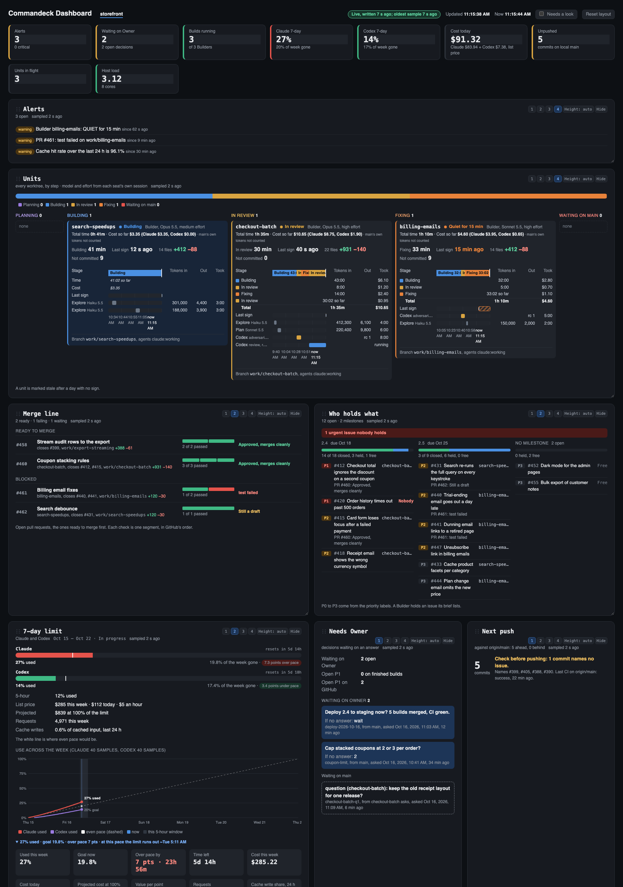
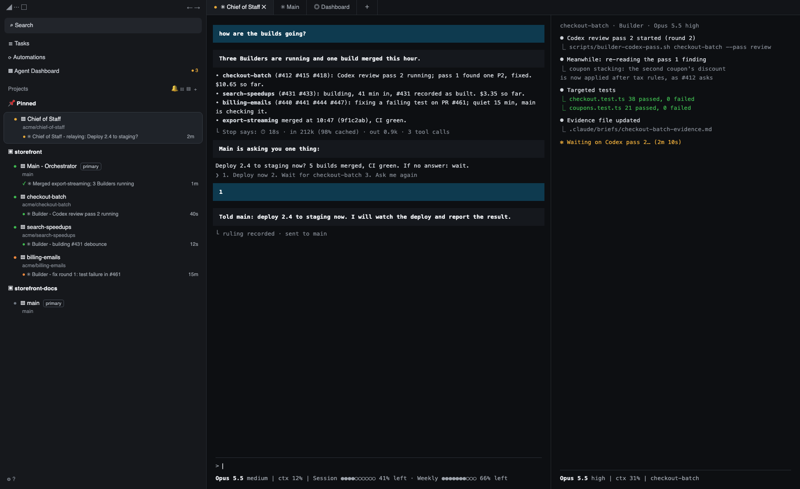

<h1 align="center">Commandeck</h1>

<p align="center">
  
  
  
</p>

---

Commandeck is a Claude Code plugin that runs on
[Orca](https://github.com/stablyai/orca). It splits agent work into three
jobs. One Claude session in your main checkout, the orchestrator, plans with
you, launches builds and merges them; it does not write the code. Each batch
of work gets a Builder, a second session in its own git worktree. A separate reviewer
session reads what the Builder committed, and the merge script takes
a branch only when it can find that reviewer's verdict for the commit being
merged: a `VERDICT: GO`, or the verified P2/P3 tail described below.

It is for a developer who wants to plan several units of work, let Builders
work in parallel, and keep review and merge evidence in one place. You still
choose the work, answer decisions and push the finished commits.

## What it looks like

The dashboard: every Builder by stage, what waits on you, pull requests and issues, and the week's
Claude and Codex limits and cost. (Sample project, invented figures.)



Orca with the Chief of Staff pinned, main orchestrating and one worktree per Builder:



## What you need

| Need | For |
|---|---|
| [Orca](https://github.com/stablyai/orca), and its command under the name `orca-ide` on `PATH` | worktrees and panes |
| Claude Code | every session |
| git | worktrees, the merge |
| GitHub CLI (`gh`), signed in | the issues a merge files for findings left open, and the dashboard |
| `jq`, `perl`, Python 3.11 or newer, Bash 4 or newer | the scripts and the hooks |
| GNU `sed`, `stat`, `date`, `readlink`, `grep`, `realpath`, `timeout`, `sha1sum` and `sha256sum`; `flock` | the scripts |
| Codex CLI and the `openai-codex` Claude Code plugin, both signed in | the `claude-openai` profile only: its review passes run on Codex |

The service code supports macOS with launchd and Linux with systemd user
services. On Windows, use WSL with systemd user services available; there is
no native Windows service backend. The table is
the list in `scripts/requirements.sh`, shared by setup and the doctor.
Scripts also run the common preflight on macOS. The setup skill checks all of it at once and names
what is missing in two groups. What a package manager supplies comes with the
one command for your machine (Homebrew on macOS, apt-get on Linux), and set-up runs that command when you say yes, and
nothing without it. The rest is yours to do, each with its printed step: Orca,
Homebrew itself, GitHub sign-in and the Codex CLI. For GitHub:

```bash
gh auth login
```

Orca is a desktop app you install yourself, from
[its releases page](https://github.com/stablyai/orca/releases): the `.dmg` for
your chip on a Mac, the `orca-ide` `.deb`, `.rpm` or AppImage on Linux. The
Linux packages name its command `orca-ide`. The Mac app names it `orca` and
puts no `orca-ide` anywhere, so on a Mac set-up offers to link `orca-ide` to
the app's own command, in a folder of yours that is already on `PATH`.
Homebrew's `orca` is another program.

On macOS, Bash 4+ and the GNU tools come from Homebrew (`bash`, `coreutils`,
`gnu-sed`, `grep`, `flock`). The scripts look in Homebrew's folders
themselves, a script the Mac's own Bash 3.2 started carries on under
Homebrew's, and the hooks are started through a launcher that finds a Bash 4
or newer, so your shell's start file needs no edit. Until that Bash is there
the hooks do not run: each says so in one line and blocks nothing.

If your `~/.claude/settings.json` sets its own `env.PATH`, that is the `PATH`
every session and hook gets, in place of your shell's. Set-up checks both: a
tool that is on one and not the other is named in one line, and the `orca-ide`
link goes into a folder on the session's. Set-up never edits that setting.

The dashboard collects registered projects whose `origin` is on GitHub.
Other git hosts have no dashboard integration. The agents, jobs and worktrees
run on one machine; model requests and GitHub calls use the network. The merge
script makes a local squash commit on `main`. Pushing it is yours to do.

Claude Code must already be installed and signed in, at version 2.1.271 or
later: the plugin's `/config` options use pickers, which came in that version.
The repository declares no minimum Codex CLI version. CI validates the plugin
with Claude Code 2.1.302; that is a test pin. The Codex
profile also needs Node.js to run the companion from the separately installed
Codex plugin. Add-ons have their own requirements. Tests additionally use
ripgrep and Node.js; see [Tests](#tests).

## Install

Add this repository as a Claude Code marketplace, then install its plugin.
Replace `<marketplace-source>` with this repository's GitHub owner/repository
or the path to a local clone. The repository URL is also recorded in
[the plugin manifest](.claude-plugin/plugin.json).

In Claude Code, as two separate prompts:

```text
/plugin marketplace add <marketplace-source>
```

```text
/plugin install commandeck@commandeck
```

Or from a terminal:

```bash
claude plugin marketplace add <marketplace-source>
claude plugin install commandeck@commandeck
```

Open a Claude Code session in your project's primary git checkout on `main`:

```text
/commandeck:setup
```

The setup skill checks requirements, asks the questions below, shows a plan,
and applies it only after you choose Apply. The underlying `setup.sh` script
asks nothing: its flags are the answers. Do not run it without choosing them.
A rerun keeps saved answers for flags you leave out.

Setup records each managed path before changing it. Existing user files it
manages get a visible sibling backup named `<file>.commandeck-bak-<date>`.
The install manifests and original content blobs live in
`~/.commandeck/install/`. Add-on installers run their own commands; those
external changes are not all covered by the file restore mechanism.

Setup writes the project config and settings, permission rules, git's local excludes, brief templates and the test-audit
workflow. Depending on your answers it also changes global rules, an AGENTS.md block, Codex hooks
and trust, prompt cache settings and auto-mode entries. It installs a main
watcher job and, if enabled, the machine's dashboard job. It creates an Orca
run and can create the Chief of Staff worktree and pane. Its output lists what
changed, what needs you and what is optional. It never commits. Review and run
the exact commit command it prints so new worktrees inherit the shared files.

Then check the wiring:

```text
/commandeck:doctor
```

The doctor reports failures and warnings without applying fixes. A failure
may name a command or explain what to repair. Resolve those before launching
a build. Start fresh sessions after changing hooks or startup settings.

For terminal examples below, `$PLUGIN` is the installed plugin folder. Setup
prints its full path in the doctor command. Setup also maintains this stable
link, so after setup you can use:

```bash
PLUGIN="$HOME/.commandeck/plugin"
bash "$PLUGIN/scripts/doctor.sh"
```

Run project commands from the primary checkout. These scripts live in the
plugin folder, not in your project.

### Updating

First update the plugin:

```bash
claude plugin update commandeck
```

Then, in each configured project:

```text
/commandeck:update
```

Or run `scripts/update.sh` from the **new plugin folder** printed by Claude
Code. Do not start an update through the stable link while it still points
at the old version.

```bash
bash "<new-plugin-folder>/scripts/update.sh"
```

Update prints the changelog, reruns setup with saved answers, refreshes the
managed hooks, permissions and jobs, and runs the doctor. Setup's add-on
selection is not saved: an update attempts the default add-on list again.
On failure, update restores the recorded files. Jobs may still need a rerun
of setup from the old folder, and external add-on updates are not rolled back.
The failure output names that limitation.

The update skill also checks whether the relay worktree is behind `main` and
offers to rebase it. It refuses a dirty relay or a conflicting rebase. Start
new Claude and Codex sessions after updating; open sessions retain startup
state.

Codebase-memory updates are deferred when its client process is detected.
Follow the printed close-sessions instructions and retry. An unknown config
schema is refused; the update skill recommends uninstalling with the old
plugin and setting up again. There is no automatic schema migration.

To return to an earlier release, install that release with Claude Code's
plugin management, then run its update script. This repository does not
supply a version-selection flag for the external CLI.

### What setup asks

Each question says what its choices do, offers the recommended one first
(a saved answer first on a rerun), and is asked only when it applies. While
setup asks, the picker guard's stray-keypress option is off.

| Question | Choices |
|---|---|
| Reviewer | `claude`: a separate headless Claude reviews each build (Sonnet by default). `claude-openai`: Codex reviews it (offered when the Codex CLI is ready) |
| Permissions | this project: the rules go in `.claude/settings.local.json`, which git never sees (they name this machine's plugin folder). Every project: in `~/.claude/settings.json`. A changed answer moves them |
| Your rules | asked when the project has a `CLAUDE.md` or `.claude/rules/`: merge (sessions leave out the plugin's rules yours already state word for word; for a rule that only says the same in other words, or disagrees, you choose keep mine, use the plugin's or keep both) or keep both |
| Your own startup files | asked each time for a project's own `AGENT_STARTUP.md` and `.claude/main-session.md`, which otherwise load instead of the plugin's: merge (the plugin's rules yours lack are added in a marked block), replace (sessions load the plugin's; yours stays on disk) or skip |
| Global rules, global CLAUDE.md | when `~/.claude/CLAUDE.md` exists: merge (only the rules it lacks), add as block, or skip; when it does not: install or skip. Your own text is never changed; uninstall takes out only the plugin's blocks |
| Builder model, context | Opus (the default) or Sonnet for less usage; no advisor is added by setup. 200K or a larger window |
| Builder effort | medium (the default), low, high or max, for every Builder; review seats keep their own |
| Builder clear line | 180K tokens of context (the default), another count, or off: past it the Builder writes a handoff and goes on in a fresh session of its pane, and its card on the dashboard shows its context against the line |
| Issue sizing | 40K tokens (the default), another count, or off: an issue the batch brief sizes as sharing no files and needing more reading than this is proposed as its own unit when the Builder is launched; off keeps today's grouping |
| Relay | none, or a Chief of Staff pane with a name and one line on how it should sound |
| Dashboard | on for this machine only (listens on 127.0.0.1), off, or on plus another name it answers to (a tailnet's): that choice listens on the network; unknown DNS names get 403, while machine names and IP addresses are accepted |
| Merge check | the command that must pass before a merge, or none |
| Full suite | on (recommended when the whole suite takes under about 10 minutes) or off: one full run of the test command per build, beside the closing review pass; a red run is a NO-GO (`--full-suite on\|off`) |
| Strict hooks | off or on (see [Hooks](#hooks)) |
| Ponytail | on (the skill is installed) or off |
| Prompt cache | 5m for main and worker panes (`promptCacheTtl` and `subagentPromptCacheTtl` in `.claude/settings.json`, `CLAUDE_CODE_PROMPT_CACHE_TTL` in each worktree's `settings.local.json`; a value you set stays), 1h for the relay pane (its worktree's `settings.local.json`, its other settings kept), each with Leave as is (writes nothing) |
| Auto mode | add two lines to the auto-mode classifier's list in `~/.claude/settings.json` (kept with `"$defaults"`; they apply in every project on this machine), leave it as is (writes nothing), or take setup's lines out; a list of yours without `"$defaults"` is never touched |
| Add-ons | All (the default), serena, agent-browser, or None; the script can select any name from `config/addons.tsv` (see [Add-ons](#add-ons)) |
| Review loop | defaults, keep saved, or tune: the most review rounds (no cap by default), whether a closing pass reads the whole branch (it runs by default), the small-build line for a one-reviewer first pass (200; off gives every first pass three reviewers), and when a finished build is flagged for a written review (30 minutes of Codex review, a third of the clock on tests or idle waits when they also pass 10 minutes, $30). Numbers are saved as typed; taking every default saves nothing |
| Plan models, plan fast | which model families planning may use, and which planning seats use the fast tier; no fast planning seats by default |
| Codex fast, Codex model | with the Codex reviewer only: fast mode, offered when your Codex config allows it, and a model id when setup found none |

Then setup prints the plan: changed files with diffs, and new files with
line counts (their content is printed only when at most 30 lines), and asks Apply, Change an answer, or Cancel. Its summary ends in three
parts: what it did, what needs you (a command it could not run, files to
commit), and what is optional (a project with no `.claude/paved-road.md`
is pointed to the template that starts it), with how to change any answer later: run
the setup skill again, or the setup script with only that flag. It also creates
the project's Orca run, or prints the one command for it. A status line is changed only if you give setup a command with
`--status-line`; uninstall restores the earlier one if the setting is still
the plugin's.

## Commands and skills

The plugin ships six skills. Type these in Claude Code; setup, update,
uninstall, handoff and worktreereview require an explicit user invocation.
Doctor can also be selected by the model when diagnosing wiring.

```text
/commandeck:setup
/commandeck:doctor
/commandeck:update
/commandeck:uninstall
/commandeck:handoff
/commandeck:worktreereview <unit>
```

| Skill | Use it for |
|---|---|
| setup | Requirements, first-time setup and changing saved answers. |
| doctor | Read-only wiring diagnosis. |
| update | Repointing managed state after a plugin update. |
| uninstall | Removing project wiring and choosing whether to delete gathered data. |
| handoff | Checkpointing and restarting the main session on demand. |
| worktreereview | A running or finished unit's HTML time, token and cost report. |

Setup also installs this project workflow. Give it repository-relative
folders, a mode and optionally a worker count:

```text
/test-audit src full 4 agents
```

With no mode it uses Basic. The count is 1–16, default 4. Basic looks
for mechanical test problems; Full also looks for missing coverage. It writes
scratch reports, leaves repository files alone and runs no tests.

If you enable the bundled Ponytail skill, invoke it separately:

```text
/ponytail
```

It supplies smallest-change coding rules. It is not a seventh Commandeck
plugin skill. Optional add-ons can expose their own commands.

## Roles and configuration

A unit starts with a batch brief and acceptance criteria. Main chooses a
planning tier with you. Planning seats write and judge the plan; you give
the build its go. A Builder works in the unit's worktree, gathers facts with
helpers, implements and runs the configured review loop. It fixes findings
and leaves evidence. Main checks the proof, runs the merge check on the
squashed tree and merges locally. The relay brings decisions to you.

[`config/routing.json`](config/routing.json) is the default routing file.
It owns launch templates, agent types, model families and effort. A model
family is resolved at launch; available model ids depend on the account.
A null effort is omitted from the command.

| Role | Default agent / model | Effort |
|---|---|---|
| orchestrator | Claude / opus | omitted |
| plan-author | Claude / opus | high |
| plan-author-second | Claude / fable | high |
| plan-judge-sol | Codex / sol | high |
| plan-judge-astra | Codex / astra | high |
| plan-judge-claude | Claude / sonnet, used without Codex | high |
| builder | Claude / opus | medium |
| codex-reviewer | Codex / sol | medium |
| claude-reviewer | Claude / sonnet, headless | high |
| design-coauthor | Claude / fable | high |
| audit-auditor | Codex / astra, headless platform audit | xhigh |
| audit-verifier | Claude / opus, headless platform verifier | omitted |
| lean-worker | Claude / sonnet helper | medium |
| lean-checker | Claude / sonnet blind checker | high |

Fable planning falls back to another allowed Claude model when unavailable.
The Claude-only profile uses its Claude judge instead of the Codex plan
judges. Its stock code reviewer is Sonnet, distinct from the default Opus Builder.
A Builder model override can make both Sonnet; the scripts do not enforce
different families.

The three plugin agent definitions in `agents/` are `commandeck:helper`
(read-only fact gathering), `commandeck:lean-worker` (edits and checks) and
`commandeck:lean-checker` (blind criterion checks). They omit CLAUDE.md and
have narrow tool lists. The model guard fills missing lean-agent settings
from routing; the helper uses Sonnet when no model is named.

| Location | Owns |
|---|---|
| `.claude/commandeck.json` | Project answers, schema version 1. |
| `.claude/settings.json` | Shared project workflow and selected cache settings. |
| `.claude/settings.local.json` | This machine's project permissions; each worktree also has its own settings. |
| `~/.claude/settings.json` | Machine-scope permissions when chosen; optional auto-mode entries and status line; the plugin's `/config` options (`pluginConfigs`), which setup fills where they are empty. A `/config` option beats the project's answer, and the doctor names where each value comes from. `maxBuilders`, the most Builders that may run at once over all units, is set there or by hand as `builder.maxBuilders` in the project's `commandeck.json`; setup asks nothing for it. |
| `~/.claude/CLAUDE.md` | Optional marked global instruction blocks. |
| `~/.codex/hooks.json`, `~/.codex/config.toml` | Codex hooks and trust, relocated when CODEX_HOME is set. |
| `~/.commandeck/install/` | Per-project and machine manifests, original blobs and saved dashboard bind/port/hosts. |
| `~/.commandeck/plugin` | Stable link to the plugin folder setup last applied. |

Use setup to change answers. Its project keys include `profile`, `testCommand`,
`strictHooks`, `serena`, `standardContext`, `builder.model`, `builder.effort`,
`builder.clearLine`, `issueSizing`, `chiefOfStaff`, `ponytail`, `cacheTtl`,
`autoMode`, `workerSkillsOff`, `workerPluginsOff`, `keeps`, `planModels`,
`planFast`, `codexModels`, `codexFast` and `reviewLoop`.

Review-loop keys are `maxRounds`, `closingPass`, `smallBuild`, `maxReviewMinutes`,
`maxTestPercent` and `maxUsd`. Setup saves tuned numeric answers as strings.
Defaults are no cap, a closing pass, one reviewer below 200 changed lines,
and report flags at 30 review minutes, a third of the clock on tests/idle
with over 10 minutes, and $30. Those report flags do not block a merge.
`generatedFiles` lets merge accept a tail of commits changing only the listed
generated paths after the reviewed commit; do not list handwritten source.

Set `COMMANDECK_ROUTING` in the launching environment to use your own routing
file instead of editing the installed copy. Project Builder and review answers
still apply. Other useful overrides are `COMMANDECK_MAIN`,
`COMMANDECK_WORKSPACES`, `COMMANDECK_SCRATCH` and `CODEX_HOME`. Git decides the
primary checkout from inside a linked worktree. The dashboard/report collector
also reads `COMMANDECK_CODEX_REVIEW_HOME`, default `~/.codex-review`, for review
spend; it does not itself change where reviewer processes run.

## The first build

After setup, the Claude session in the project's main checkout is the
orchestrator. You tell it what you want in plain words. It writes a batch
brief with you (the items and how each will be judged done), asks whether
to write a plan first (Auto, no plan, one planner, a plan and a judge, or a panel
of two plans, two judges and one merge), and once you say go launches a Builder (a batch that
names no committed plan is refused unless launched with
the explicit skip shown below; the Builder can take over the unit's
planning worktree once its plan is on main):

```bash
bash "$PLUGIN/scripts/builder-launch.sh" add-csv-export .claude/briefs/add-csv-export-batch.md
```

You do not type that; the orchestrator does. The launcher makes a new Orca
worktree on local `main` (after fast-forwarding from `origin` where available),
puts the rendered brief in it, opens one Builder
pane and prints one line:

```
seat=builder unit=add-csv-export handle=term_… task=task_… state=… record=…
```

The Builder builds the batch, then runs its own review passes with
`builder-codex-pass.sh` (or `builder-claude-pass.sh` in the `claude`
profile). Each pass commits the worktree first, excluding its brief files, so the
reviewer reads a fixed commit, and writes a round file from the reviewer's own session record.
The merge takes the verdict from the reviewer's session files and not from
the round file, so a round file written by hand merges nothing. That stops a
Builder from passing itself by mistake. The session files belong to the same
user, so it does not stop an agent that sets out to forge one. A pass prints:

```
add-csv-export-r1-reports.md: VERDICT: GO (adversarial pass on 3f9c2a1, …)
```

A watcher service, `main-watch.sh`, installed by setup, posts a message to
the orchestrator when the Builder's pane stops (not while it waits on a helper
or a review pass it started, for up to an hour). The orchestrator then runs
the merge from the main checkout:

```bash
bash "$PLUGIN/scripts/merge-unit-local.sh" add-csv-export
```

```
STEP 1 preconditions: main=… worktree=… branch=add-csv-export
STEP 2 rebase: git -C … rebase main
STEP 4 size: 4 files changed, 212 insertions(+), 9 deletions(-)
STEP 4 merge: git merge --squash add-csv-export; npm test; git commit -m …
STEP 5 cleanup: orca-ide terminal close --worktree … --all; orca-ide worktree remove --worktree … --force
DONE unit=add-csv-export merged=local sha=8d41e07; …; nothing was pushed
```

A project that runs its own watcher and posts Claude Code's heads-up notes itself writes
`<scratch>/heads-up-owner` (`pid=`, `main=` the full checkout path, `at=` epoch, no later than that cycle's
read of the offer store) each cycle it posts.
While that claim is live (pid alive, same checkout, under 300 s old), `main-watch.sh` posts nothing: no
finished, stopped, stalled or heads-up item, so write the claim only on a cycle that posts all of them. It
counts a note as the owner's only when the offer was shown before `at=` and is still shown, and any other item
as the owner's once `at=` is past the tick that first saw it; the rest wait and are posted once the claim ends.
An item the owner posted is not handled: once the claim ends, it is reminded every 5 minutes until main closes its task.
A watcher that stands down writes no claim.

Those are some of the lines the scripts print, with example values filled
in. Between
steps 2 and 4 the merge looks up the reviewer's session and refuses when the
proof is missing or older than the branch tip. It runs your test command once
on a copy of the squashed tree before it commits, and a red run undoes the
squash. Then it closes the unit's panes and removes the worktree. It does
not write the build review: that runs only when you ask for it.

To inspect worktrees, seats and open tasks:

```bash
bash "$PLUGIN/scripts/board.sh"
```

To check merge preconditions and print its plan without rebasing, merging or
removing the worktree:

```bash
bash "$PLUGIN/scripts/merge-unit-local.sh" add-csv-export --dry-run
```

This dry run does not run the configured test command. A failed real check
undoes the squash. Exit 3 means the merge committed but archiving or cleanup
failed: finish that step by hand. Exit 4 means it merged but could not file
all open findings as GitHub issues: use the printed retry command. Do not
merge an already merged unit again.

The launcher refuses a batch without a nonempty plan committed on `main`,
unless main explicitly records a skip:

```bash
bash "$PLUGIN/scripts/builder-launch.sh" --skip-plan --reason 'Small documentation change' add-csv-export .claude/briefs/add-csv-export-batch.md
```

Auto planning reads `config/plan-triggers.tsv`, or the project's
`.claude/plan-triggers.tsv`, and reports the tier and trigger it chose. The
batch and Builder templates are in `templates/`. Main should write explicit
acceptance criteria and a merge check before launching.

## Review passes

A build's first pass reads the whole branch. It is three reviewers at once,
one angle each, unless the commit is under 200 changed lines, or the number set at setup (insertions plus
deletions against `main`) and the build was not launched with `--risky`; then
it is one reviewer told all three angles. The pass prints which rule chose,
and the merge counts the lines again and refuses a one-reviewer first pass
the rule did not allow.

After that come narrowed passes, each reading only the changes since the last
one, until one ends `VERDICT: GO`. A closing pass then reads the whole branch
again. If the first pass ends GO and nothing is committed after it, that GO
merges and no closing pass is needed. A project that answered "none" to the
closing pass at setup merges the narrowed pass that ends GO, once narrowed
passes have read every commit after the first pass; one that set a round cap
has any pass numbered above it refused.

Each pass after the first prints the files and lines changed since the last
pass, and says so when no code line changed (only comments or blank lines). If
main's brief or rulings for the build changed since the last pass, a `review`
pass reads the whole branch as a closing pass does, so a part main added in a
fix round is reviewed with the rest. The Builder's evidence-file lines
`Different fix r<N>: <why>` and `Other cases checked r<N>: <which>` go into the
prompt of pass N.

Each pass is checked against its saved prompt and its own reviewer session,
and earlier passes are checked too. Prompts are kept under the reviewer
home's `builder-pass-prompts/`. An update to the external Codex plugin's
prompt alone does not invalidate a saved pass. A missing prompt record, a
changed session prompt, or an incompatible change to this script's required
review text can still refuse it. Follow the refusal; a new unit reviewed
from pass 1 is the recovery it names.

Findings are graded P0 to P3. A P0 or P1 refuses the merge. A closing pass
that leaves only P2 or P3 findings still merges: the merge prints each one as
open and files a GitHub issue for it. If GitHub cannot be reached the merge
stands, the output lists what was not filed, and the exit code is 4.

A launch with `--risky` opens a design pane first. It writes a design note
that the Builder reads before it builds; running the same command again opens
the Builder at the effort the first call recorded. Given `--effort` and `--reason`,
that second call rewrites the brief's override and logs the change in the evidence
file before the Builder opens; it refuses while that Builder already runs. Setup adds no advisor, including for risky builds. A manually configured
`roles.builder.advisor` can still add one. A
launch with `--small` says the batch is expected under 200 changed lines; it
also drops an advisor written into `config/routing.json`'s `roles.builder` by
hand. A model override with a reason puts one launch on another allowed model.
For example:

```bash
bash "$PLUGIN/scripts/builder-launch.sh" --small --model sonnet --reason 'Small tooling change' add-csv-export .claude/briefs/add-csv-export-batch.md
```

To merge several finished units in order:

```bash
bash "$PLUGIN/scripts/merge-queue.sh" first-unit second-unit
```

The queue stops when a unit is refused or cleanup fails after its merge.
It continues past issue-filing failures and returns 4 after the queue ends.

## Hooks

The hooks catch mistakes; they are not a security boundary against an agent
or process running as your user. Most are registered in
[`hooks/hooks.json`](hooks/hooks.json). Builder and worker hooks are added by
`worktree-setup.sh`. A warning allows the call; a block refuses it.

The default tier applies in configured projects, subject to each hook's seat
and event checks:

| Hook | What it does and why |
|---|---|
| `git-safety.sh` | Blocks force pushes, remote branch deletion, mirror pushes and hard resets to protect work; it handles quoted command words, but does not interpret arbitrary shell evaluation. |
| `main-edit-guard.sh` | Blocks main from writing project code, including code in its worktrees; allows instruction and documentation paths, but caps counted uncommitted files at three even under `.claude/`. |
| `duplicate-agent-guard.sh` | Blocks a second live agent in one worktree and a new job sent to a busy pane. |
| `dependency-addition-guard.sh` | Blocks unapproved new npm packages in install commands and package edits; protects dependency and supply-chain decisions. |
| `literal-secret-warning.sh` | Warns about quoted secret-like literals of eight or more characters in executable code; excludes tests and config/env files. |
| `agent-model-guard.sh` | Fills missing helper models, forces Builder Explore calls to Haiku, and suggests lean helpers; it never refuses the call. |
| `no-poll-loops.sh` | Blocks main's sleep polling, unqualified Orca inbox checks and worker foreground waits past the cache budget; use event waits or background jobs. |
| `worker-ask-guard.sh` | Blocks worker pickers that would never reach you; main and the relay can ask, with a decoy first option outside setup. |
| `write-existing-file-guard.sh` | Warns when a large edit mostly repeats existing lines, so the edit can stay small. |
| `agent-startup-context.sh` | Loads instructions for the seat; does not block. |
| `resume-context.sh` | Loads a pending main checkpoint, board and run binding once; does not block. |
| `agent-awareness.sh` | Reminds main about dispatched work and unfinished state; does not block. |
| `context-line.sh` | Prompts main to checkpoint at its clear line and Builders to write a fresh-session handoff; does not block. |
| `context-clear-stop.sh` | Holds main's stop for a checkpoint, checks carry-over and starts the Orca restart when eligible. |
| `ask-records-decision.sh` | Records main's picker questions and blocks repeated unresolved or recently answered questions. |
| `ask-stop-records-decision.sh` | Holds a stop when a plain-text question was not entered in the decision ledger. |
| `ruling-log.sh` | Records owner answers with ids and flags suspiciously fast picker answers; does not block. |
| `cos-own-echo.sh` | Acknowledges the relay's own message echoes so they do not cause another turn. |
| `cos-inbox-waiter-stop.sh` | Holds the relay's stop until all four watchers are alive. |
| `opus-orchestrator-autonomy.sh` | Loads main's autonomy instructions and blocks an Opus orchestrator stop asking to continue already authorized work. |

The strict tier is off by default. Setup saves the answer as `strictHooks`
in `.claude/commandeck.json`:

| Hook | What it does and why |
|---|---|
| `test-skip-only-blocker.sh` | Blocks focused, skipped and todo tests that could hide failures. |
| `suite-rerun-guard.sh` | Blocks the same completed test/type-check command on an unchanged tree within 30 minutes; recognizes npm test/typecheck, tsc and Vitest. |
| `edit-content-tripwires.sh` | Blocks new CRLF, deferred-work markers and specified TypeScript/lint suppressions, with the exemptions and reason annotations in its rule table. |
| `file-size-cop.sh` | Blocks a whole-file Write crossing 500 lines for TS or 400 for TSX; an Edit crossing the cap warns and asks for a follow-up. |
| `bash-guardrails.sh` | Blocks Node test runs without the 4 GB heap cap and refuses unsupported heredoc end words so commands remain inspectable. In a Builder it also refuses, in every tier, an inline Python, Perl or Node script that writes a tracked file: that edit goes through Edit. |
| `pane-budget-gate.sh` | Holds workers for missing configured code-server startup or a handoff after the pane budget is exhausted. |
| `read-tracker.sh` | Nudges shell-only source searching when configured code navigation is unused. |
| `batch-independent-looks.sh` | Advises batching after three turns with one read-only call each; also active for planning seats without strict mode, and for Builders at the second such turn. |
| `script-over-reads.sh` | Advises using a script after five same-kind files from one directory. |
| `git-ignore-warn.sh` | Warns when a written file is ignored and would not ship, except deliberate scratch paths. |
| `new-test-file-guard.sh` | Advises extending an existing test when another file already tests the imported subject. |
| `staged-index-warn.sh` | Reports indexed files whose working copies differ after a suite; this is not proof of which bytes the test read. |
| `web-fetch-blocker.sh` | Despite its name, only advises using agent-browser for browser-dependent pages; it allows the fetch. |

Only use approval overrides after the corresponding decision. For an npm
install, the approval is in the command text:

```bash
COMMANDECK_DEP_APPROVED=1 npm install <package>
```

For a direct package.json edit, the hook instead reads an exact comma-separated
package list in `COMMANDECK_DEP_APPROVED` in the worktree's settings env.
A deliberate repeat test run uses:

```bash
RERUN=1 npm test
```

Worker-specific hooks:

| Hook | What it does and why |
|---|---|
| `builder-search-guard.sh` | Blocks long consecutive searches and whole-repository searches in the Builder's main thread; sends fact gathering to Explore helpers. A search for one bare identifier gets a symbol-lookup note. |
| `read-range-guard.sh` | Blocks a Builder's Read of a whole text file over 400 lines; names a `grep -n` and a range to read instead. |
| `builder-event-log.sh` | Records tool, helper and review activity in the worktree's `.claude/builder-events.jsonl`; does not block. |
| `claude-worker-notify.sh` | Notifies main when a Claude worker stops; does not block. |
| `codex-notify.sh` | Notifies main when a Codex turn ends; does not block. |

In the Codex profile, `codex-dispatch.sh` translates Codex hook events and
patches into the registered hooks' payloads. Setup writes five event entries
in Codex's `hooks.json`. Dispatch requires a configured project and Codex
trust for the checkout or its primary checkout. Claude-only hooks marked
`# codex: skip` are omitted. `hooks/lib/run-hook.sh` finds Bash 4+; without it,
it prints a warning and none of the plugin's hooks run.

Several checks understand only npm and TypeScript. Other stacks get only the
checks whose patterns apply.

## What each pane starts with

A worker pane starts with less context than main. `scripts/worktree-setup.sh`
writes the settings into its `.claude/settings.local.json`.

| Seat | Startup settings |
|---|---|
| Main | The worktree setup script does not change main. |
| Worker or Builder | Disables business plugins, memoir, selected connectors and code/browser tools; disables auto memory; drops Stripe and three browser skills unless kept; uses the Ponytail summary when applicable. |
| Chief of Staff | Disables code and business plugins, selected MCP servers and connectors; keeps the owner's Ponytail setting and uses relay-only permissions. |

A brief must carry facts the worker needs because auto memory is off.
The exact tool and plugin lists live in `scripts/worktree-setup.sh`.
A keep word restores its named skills and plugins. Billing keeps Stripe;
all skips the additional skill/plugin, auto-memory and Ponytail-summary cuts.
It does not undo the earlier worker tool, MCP, business-plugin or memoir settings.

```bash
bash "$PLUGIN/scripts/builder-launch.sh" --keep billing add-csv-export .claude/briefs/add-csv-export-batch.md
bash "$PLUGIN/scripts/worktree-setup.sh" "<worktree-path>" --keep billing
```

The keep list is stored in the worktree; a rerun without it retains that list.
The doctor warns about main-checkout settings that can shadow the worktree's.

Your own lists go on top. Setup asks for the skills and plugins worker and Builder panes turn off, and for keep
words: `workerSkillsOff` (skill names, written as `skillOverrides` `"off"`), `workerPluginsOff` (`plugin@marketplace`
keys, written as `enabledPlugins` `false`) and `keeps` (a word and the skills and plugins it brings back) in
`.claude/commandeck.json`. A keep word brings its set back for one unit, a plugin cut by default (the business
plugins, memoir, ponytail) included; a rerun after a list shrinks takes the dropped names back out. A name you set
yourself in a worktree's `settings.local.json` keeps your value. The extra user lists default to empty; the built-in cuts still apply. Plugin
skills cannot be turned off one at a time. Only a whole plugin can be.

## Chief of Staff

The Chief of Staff is a separate Claude pane that relays between you and the
orchestrator, so questions for you arrive in one place while builds run. It
reads no code and never answers for you.

When you choose one, setup creates an Orca worktree named `Chief-of-Staff`,
gives it its relay-only settings and opens the pane under the stored name.
Where it cannot (Orca does not answer, or the worktree is already there), it
ends with the exact commands left to run. The session in the main checkout is
the orchestrator and never the relay; its start-up text says where the relay
pane is, or that none exists yet. Without one, the orchestrator asks you
directly.

The pane keeps four watchers running in the background. Each one prints what
it found and exits, which wakes the pane:

| Watcher | Wakes the pane when |
|---|---|
| `cos-watch-inbox.sh` | the orchestrator sends it a message, or anyone sends to its own handle (checked every 20 s). A subject starting `FYI` is held and shown with the next message that does wake it, unless it was sent to its own handle |
| `cos-watch-decisions.sh` | a decision in the ledger is open and you have not been asked yet (every 20 s) |
| `cos-watch-alerts.sh` | the dashboard raises an alert for this project or the machine (every 60 s) |
| `cos-watch-limit.sh` | the 7-day usage limit reaches the threshold, 90% by default, and again for each whole percent above it |

A Stop hook keeps the pane from ending a turn unless all four watchers are alive.
To send text from a terminal, including a dictation shortcut:

```bash
bash "$PLUGIN/scripts/cos-tell.sh" 'What needs my attention?'
```

Main's durable note uses:

```bash
bash "$PLUGIN/scripts/cos-tell.sh" --note 'Build ready' 'The export unit is waiting for review.'
```

That note is stored in the orchestrator's run,
where the inbox watcher finds it even if the pane was busy, and it exits 1
when Orca does not confirm the note was stored.

The decision ledger is `.claude/metrics/decisions.jsonl` in the main
checkout. Picker questions are recorded by a hook. A plain-text question
must be entered in the ledger; a Stop hook holds an unrecorded question.
The dashboard's "Needs the owner" card reads the ledger.
`scripts/decision.sh` has add, check, answer, reopen and list operations. A
question that is still open, or was answered in the last 24 hours, cannot be
asked again without `--reask` and a line on what is new.

The ruling log is `~/.claude/rulings/<project>.jsonl`. A hook appends one row
for recognized answers, by picker or by prompt, with the time it happened
and an id. Slash commands and recognized control or nudge prompts are skipped. Agents cite that id when they write "the owner decided X", so a
decision can be traced to your words. An answer that comes back in under two
seconds is marked suspect: it may be text another pane typed into the open
picker.

## Cost control

- Startup size. The plugin budgets hook output at 10,240 bytes to avoid
  Claude Code truncating startup context. `scripts/startup-size.sh` measures
  each seat and exits 1 over the limit; it supports `--role` and `--per-prompt`.
- The clear line. Past 200K tokens of context (150K with
  `--standard-context`) the orchestrator gets a line on every prompt telling
  it to checkpoint. See [Checkpoints](#checkpoints-resume-and-handoff).
- The pane budget (strict tier). A worker pane past 450,000 tokens of context
  (the fallback in `config/pane-budget.json`; measured budget data can replace it)
  may not edit or run commands until it has
  written a handoff file with its decisions, open findings, current commit
  and test evidence.
- The cache check. `scripts/builder-cache-check.sh`
  reads a Builder's transcripts and fails unless its main thread wrote only
  5-minute prompt cache, and its subagents only 5-minute cache.
- The price of each build. The build review prices every request at list
  price from one table in `scripts/dashboard_limit.py` and flags a build over
  $30. These are list-price equivalents and a subscription plan bills
  differently. A model with no list price on file is shown as unpriced,
  never as $0.
  `scripts/unit-cost.sh` prints a build as turns, tool calls
  and tokens per session.
- Helper usage. `scripts/subagent-usage.sh` records one row per finished
  subagent run (type, model, tokens) in
  `.claude/metrics/subagent-usage.jsonl`. `scripts/seat-tokens.sh` totals
  tokens per unit and per role.
- The 7-day limit. The dashboard reads your account's usage and shows the
  7-day limit for Claude and Codex; the limit watcher above tells you at
  90%.

## Checkpoints, resume and handoff

Main is instructed to checkpoint and restart instead of compacting. Past the
clear line, a Stop hook asks for a checkpoint at
`~/.claude/checkpoints/<session-id>.md`, using `templates/checkpoint.md`: the
goal, live units, waits, queue, rulings and how to resume.
`scripts/state-snapshot.sh` fills the mechanical fields. A fresh checkpoint
is under 30 minutes old.

In Orca, the hook can open a fresh main pane, supply the resume prompt and
close the old pane after takeover. Background helpers can defer a restart;
failures leave the old pane available and write `clear-hook.log` beside the
checkpoints. This is not a guarantee that Claude Code will never compact.
Idle compaction is Claude Code's behavior, not a compactor supplied here.
The repository does not establish the runtime's exact idle-compaction version,
timeout or settings contract.

The new session starts with that checkpoint, the board, its run binding and
up to your last eight prompts word for word, under the same 10,240-byte
limit. When the block is too large it substitutes pointers or omits older
prompts, so the new session may need to read the source files. A check compares the new checkpoint with the one the
session resumed from and blocks the restart when an open item was dropped
without a reason.

The handoff skill does the same checkpoint and restart on demand, below
the line. You have to type it; the model cannot invoke it:

```text
/commandeck:handoff
```

Outside Orca the hook cannot restart the pane. It says so and asks you to
clear the session manually, and the new session does not get the resume block.

## Dashboard, build review and test audit

The dashboard is one local page for all your projects, with a bar to switch
between them. A background job waits 60 seconds between collections, with no
model call; collection time adds to that interval. The page refreshes its
data every 15 seconds. Each project's view shows alerts,
builds in progress, decisions waiting on you, `main` against its remote,
every worktree by stage, a unit's planning as its Planning stage, seat by seat,
counted in its build's cost, the 7-day limit, tokens per role over 7 days, recent
hook blocks and the Chief of Staff's inbox. Three panels show GitHub work:
open pull requests with their checks, open issues by milestone with the
Builder holding each, and the commits the next push of `main` would send.
They read `gh` (read-only, every 5 minutes) and git. Without `gh`, or signed
out, each says so and the rest of the page still works. An issue number links
to the issue on GitHub.
A planning card lists every plan seat with its model, effort and state;
`COMMANDECK_CODEX_REVIEW_HOME` (default `~/.codex-review`) names the review
Codex home whose spend counts.

It serves plain HTTP on `127.0.0.1`, on the first available port in 8791–8890 unless you set a port, and
setup prints the address. It has no login. On the loopback bind it answers
403 to any other host name; `--bind` and `--hosts` at setup open it to your
own network, and it still has no login there. Network mode also accepts
the machine's own names and IP addresses; the hosts list is not an
authentication mechanism.

The build review runs only when you ask for it, for a merged build or one
still running:

```text
/commandeck:worktreereview add-csv-export
```
The merge does not run it. It makes one HTML page per build under
`~/.commandeck/reviews/`, with the session's notes on what to learn from it.
It shows where the time went stage by stage, every review pass with its full
findings and lines changed, tokens and list-price cost by model, and time
spent waiting. The page flags a build with over 30 minutes of review, over
$30, or over a third of its clock (and over 10 minutes) on tests or idle
waits; that flag names the largest single command. A wait on a review pass
run outside the Builder's session, or on a review tool that was down, is
shown on its own and flags nothing. A lesson that proposes a change becomes
a draft issue, and only the drafts you approve are filed. It reads logs
only, so it works after the worktree is gone.

The test-audit workflow has agents read a
folder's tests against its code and report what is redundant, slow or unable
to fail, and in `full` mode what is missing. Up to 16 Haiku agents read in parallel (4 by default), and a
last Sonnet stage checks the audit itself: that every file was read and that
the counts agree. It changes no repository file and runs no test; it writes reports to scratch. It stops above 200
test files, so give it a folder and not the repository. It is a Claude Code
workflow, which setup installs in the project and turns on.

### Dashboard panels and mobile use

Open the HTTP address setup prints. If you lost it, the read-only job-file
command prints the path to the service configuration; read that file for the
port. The status command checks whether the job is running:

```bash
bash "$PLUGIN/scripts/dashboard.sh" --job-file
bash "$PLUGIN/scripts/dashboard.sh" --status
```

| Panel | Shows |
|---|---|
| Alerts | Current project and machine warnings, with source freshness. |
| Builds in progress | Active builds and their progress. |
| Needs the owner | Open decisions, questions and high-priority findings. |
| Main | Branch state against its remote and recent commits. |
| Units | Planning, Building, In review, Fixing and Waiting on main, with seat activity and cost. |
| Merge line | Open GitHub pull requests and their checks. |
| Who holds what | GitHub issues grouped by milestone and the unit holding each. |
| Next push | Local main commits ahead of origin/main and related checks. |
| 7-day limit | Account usage windows where available, history and list-price spend; API billing uses a spend view. |
| Main's to-do list | The project's `todo/main-todo.md`. |
| Host | Machine load and swap readings. |
| Tokens per role, 7 days | Input/output totals across roles and models. |
| Recent guard blocks | Recent blocking hook events and counts. |
| Chief of Staff's inbox | Relay messages for the project. |
| Main's background agents | Main's running helper agents. |

Panels can be reordered, resized, folded and hidden. Needs a look filters for
warnings and pending work. Layouts are kept per project in browser storage
and saved on the dashboard host, so another browser can pick them up. These
layout writes are the page's supported server mutation; it does not merge
branches or answer decisions.

At phone width, panels use one column with bottom navigation and stage chips.
To reach the page from another device, choose network access in setup, or
apply the corresponding settings after reviewing that the server has no login
and uses plain HTTP:

```bash
bash "$PLUGIN/scripts/setup.sh" --dashboard --bind 0.0.0.0 --hosts <dashboard-name>
```

Replace the name with the one the other device uses for this machine. This
changes the machine's shared dashboard service. Use the printed port. Unknown
DNS names are refused, but IP access and the machine's own names are allowed.

## Numbers

`scripts/proof-run.sh` builds a throwaway fixture machine in a temporary
folder: an isolated home with existing settings, a small Node project, and
stubs for Orca, Claude, Codex and the service manager. It runs setup, a scripted
unit and uninstall for each profile. No real model or service is started.

It reports startup bytes, scripted hook counts and timings, clear-line checks
and restoration of fixture files. These are fixture measurements, not a
promise of production speed. Tokens, cache behavior, real review convergence
and restart takeover need a live build; the script labels those not measured.
Run it from a clone when you want current figures:

```bash
bash scripts/proof-run.sh
bash scripts/proof-run.sh --profile claude
```

## Add-ons

Setup's default is to attempt the add-ons listed in `config/addons.tsv`.
Commands with installers install or update to latest; no version is pinned.
Entries that say to see an upstream installer page need manual installation.
The full Ponytail plugin is attempted by default only if already enabled and
the setup Ponytail answer is on. The bundled Ponytail skill is separate,
on by default and never overwrites an existing copy.

Selecting specific add-ons or None limits **that setup run**. The selection
is not saved, so a later setup or update without a selection attempts the
default list. Setup prints failures under Needs you and prints commands for
anything it did not install. A successful setup message does not mean every
add-on succeeded.

| Add-on | What it adds | Local cost or setup behavior |
|---|---|---|
| serena | Symbol lookup | Language-server processes; selecting it enables its hook setting unless explicitly disabled. |
| codebase-memory | Repository graph | Background indexer and MCP tools; manual first install, then guarded updates and a tool-list check. |
| agent-browser | Browser automation | Global npm package and a browser download. |
| ponytail, full plugin | Startup coding rules | Separate from the bundled on-demand skill; its registry description estimates about 1 KB of rules. |
| ui-themes | Theme skills | Installed by a plugin command; loaded when requested. |
| Engineering-skills add-on | Engineering skills | No one-line installer in this registry; skill descriptions add session context. |

Upstream sources and recorded licences are in [`NOTICE`](NOTICE). That file's
older statement that setup only prints add-on commands is stale; the current
`setup.sh` and `config/addons.tsv` determine installation behavior. Uninstall
does not remove external add-ons or undo their updates.

## Layout

| Path | Holds |
|---|---|
| `.claude-plugin/` | the plugin manifest and a one-plugin marketplace |
| `config/routing.json` | each role's agent, model family and effort |
| `scripts/` | the Builder flow and the orchestrator's tools; `paths.sh` is the one home of every path |
| `hooks/` | the hook scripts and `hooks.json`, which registers them |
| `dashboard/` | the dashboard's page; `scripts/dashboard.sh` collects its data |
| `templates/`, `skills/` | the brief, checkpoint and Codex templates and the test-audit workflow; the setup, doctor, update, uninstall, handoff and build review skills |
| `ci/` | the leak test, its word list and the release-version check |

Plugin state lives under `~/.commandeck/`, with project ledgers, Claude logs
and Codex logs in the locations below; the record of what setup changed is in
`~/.commandeck/install/`. Worktrees go under `~/orca/workspaces/<project>/`.
Environment overrides start with `COMMANDECK_`; `scripts/paths.sh` lists the
path ones.

## Uninstalling

In every configured project, while the plugin is still installed:

```text
/commandeck:uninstall
```

The skill asks whether to keep or delete gathered data. The equivalent
terminal commands are alternatives; choose one:

```bash
bash "$PLUGIN/scripts/uninstall.sh"
```

```bash
bash "$PLUGIN/scripts/uninstall.sh" --delete-data
```

Uninstall stops that project's watcher, removes its dashboard registration
when setup added it, and restores managed project files. In merged settings
it removes the plugin's entries and preserves your later edits. A `changed
since setup` line means that file cannot be restored byte for byte. The last
project releases the machine's managed Codex hooks, dashboard job, global
entries, installed Ponytail skill and unchanged managed status line.

By default it keeps decision, seat and helper ledgers, scratch, hook logs,
rulings, relay state and finished-build records. Delete-data removes those
for this project, and the dashboard's generated data with the last project.
It can be run later to remove kept data. It leaves briefs, review rounds,
checkpoints, HTML reviews, Claude/Codex transcripts, your visible backup
copies and external add-ons. It does not promise to remove active Builder
or relay worktrees: inspect those in Orca and keep any unfinished work.

After uninstalling the wiring in every project, remove the plugin package:

```bash
claude plugin uninstall commandeck
```

## Troubleshooting

Start with the doctor in the primary checkout and keep its FAIL and warn
lines. Do not treat a successful setup exit as proof that optional add-ons
worked.

| Symptom | What to check |
|---|---|
| Setup lists missing tools | Install the reported tools, or accept its exact package-manager command. Compare shell PATH with `env.PATH` in global Claude settings. Setup does not edit that PATH. |
| Hooks say no Bash 4+ | Install a newer Bash; on macOS use the Homebrew package. Until then the plugin's hooks check nothing. |
| Linux/WSL jobs do not start | Make sure systemd user services are available for the logged-in user. There is no Windows-native backend. |
| Setup refuses a duplicate project name or record | It guards shared watcher/log names and normalized path collisions. Use a distinct checkout folder name or uninstall the conflicting project first. |
| Builder refuses to launch | Commit the referenced nonempty plan on main, check the batch path and review preflight, or record an explicit reason to skip the plan. |
| Codex reviewer cannot start | Check Codex sign-in, the separately installed Codex plugin's companion, account models and any fast-tier setting. The real pass also probes provider access before committing. |
| Claude-only review cannot start | Check that the configured Claude reviewer role is usable and Claude is available. If you changed the Builder to Sonnet, choose a different reviewer family yourself. |
| Merge refuses proof | Review the current tip again as directed. Missing reviewer sessions or saved prompts cannot be replaced by typing GO into a round file. |
| Merge check is red | Fix the reported failure in the Builder. The squash is undone; rerun review if the code changes. |
| Merge exits 3 or 4 | The commit already exists. Finish cleanup for 3; file the missing issues using the printed command for 4. |
| Dashboard is missing or stale | Check its status and job file, its registered GitHub origin, GitHub sign-in, and each source's error/freshness. A slow collector adds time to the 60-second sleep. |
| Dashboard returns 403 | Open its own page at the loopback address, or use a configured network name/IP. Cross-site requests are refused. |
| Relay is silent | Check the stored relay name, project run and all four watchers. FYI notes wait for a waking message. |
| Worker waits on an unseen picker | Workers must send questions through Orca to main; only main and the relay have owner-facing pickers. |
| Worktree settings have no effect | Read the doctor's shadow warnings and main's settings.local.json. Start a fresh session after fixing precedence. |
| Handoff leaves the old pane open | Read `~/.claude/checkpoints/clear-hook.log` and the next prompt's HANDOFF NOT DONE line. Fix checkpoint freshness/carry-over or Orca takeover before retrying. |
| Update fails after rewriting files | Read its rollback message. Recorded files are restored, but jobs may need old setup rerun and add-ons may already have updated. |

## Security and privacy

Agents run on your machine, using your credentials and tool permissions.
Claude and Codex requests send prompts, code, diffs and relevant context to
their configured providers. Codex can use a provider configured in its own
config; it is not restricted here to one endpoint. Add-on installers download
code and packages and may start MCP servers or browser processes. Review their
commands in `config/addons.tsv` before applying setup.

The dashboard collector calls GitHub through gh for issues, pull requests,
milestones and checks. A local merge can create GitHub issues containing open
findings. Build-review issue drafts are filed only after your approval.
The account-usage reader uses Claude credentials from the macOS keychain or
`~/.claude/.credentials.json` to call Anthropic's usage API. Codex limit
readings and token totals come from local session records. The dashboard
collector makes no model call; the plugin does not supply a separate hosted
dashboard backend.

Local records can contain code, prompts, paths and your decisions:

| Location | Stored data |
|---|---|
| `.claude/briefs/` | Batch briefs, rendered Builder instructions, evidence and review rounds. |
| `.claude/metrics/` | Decisions, seat events and helper usage. |
| `~/.commandeck/scratch/` | Per-project orchestration and temporary state. |
| `~/.commandeck/builds/`, `~/.commandeck/reviews/` | Finished-build records and HTML reviews. |
| `~/.commandeck/dashboard/` | Collected snapshots, usage caches/history, project registrations and saved layouts. |
| `~/.commandeck/install/` | Restore manifests and original configuration contents; treat backup blobs as private. |
| `~/.claude/projects/`, `~/.codex/sessions/` | Claude and Codex transcripts, under the active homes. |
| `~/.claude/checkpoints/`, `~/.claude/rulings/` | Resume checkpoints and recorded owner answers. |
| `~/.claude/hook-fire-log/` | Hook timing and action summaries. |
| `<reviewer-home>/builder-pass-prompts/` | Exact prompts used as review evidence. |

The dashboard is unauthenticated HTTP. Loopback is the default. Network mode
exposes its snapshots and layout controls to reachable clients; host and
same-origin checks are not user authentication or encryption. Keep it on a
network you trust. Hooks and reviewer evidence deter mistakes, but a process
with your filesystem access can forge local records. The literal-secret
warning is a narrow pattern check, not a full secret scanner.

Do not publish logs or reports without reviewing them. Report vulnerabilities
privately through this repository's Security tab, as described in
[`SECURITY.md`](SECURITY.md). Only the latest release is supported there.

## Tests

From a clone, list or run the ordinary shell suite:

```bash
bash scripts/run-shell-tests.sh --list
bash scripts/run-shell-tests.sh
```

The runner covers top-level shell tests in `hooks/__tests__/` and
`scripts/__tests__/`. Parked tests are reported as skipped. Tests marked
own-lane are skipped by the ordinary run and have a separate mode:

```bash
bash scripts/run-shell-tests.sh --own-lane
```

For a focused check, compare to `main` from a branch:

```bash
bash scripts/run-shell-tests.sh --changed main
```

This selects edited tests and same-name tests for changed scripts or hooks;
it does not discover every caller of a shared helper. With no base argument,
the base is HEAD. Documentation changes select no shell tests.

The other repository checks are:

```bash
bash ci/leak-test.sh
bash ci/version-check.sh
claude plugin validate .
bash scripts/startup-size.sh
```

Version check compares to `origin/main` by default. Documentation-only changes
need no version bump. Plugin changes need a version and changelog entry; see
[`CONTRIBUTING.md`](CONTRIBUTING.md).

Use the runtime requirements above plus ripgrep and Node.js. Dashboard DOM
tests need jsdom 26. CI installs it into a temporary prefix and supplies the
path rather than adding a project dependency. To match that locally:

```bash
COMMANDECK_TEST_DEPS=$(mktemp -d)
npm install --prefix "$COMMANDECK_TEST_DEPS" --no-save jsdom@26
COMMANDECK_TEST_NODE_MODULES="$COMMANDECK_TEST_DEPS/node_modules" bash scripts/run-shell-tests.sh
```

The runner needs Bash 4+ and GNU tools. CI uses Ubuntu's jq 1.7; verify against
that version when changing jq programs. Test concurrency and per-file timeout
can be set with `COMMANDECK_SHELL_TEST_JOBS` and
`COMMANDECK_SHELL_TEST_TIMEOUT`. Defaults are half the CPUs (at least one)
and 120 seconds, except a test's own timeout marker.

Contributions should branch from `main`, keep one change per pull request,
and add a test that fails without a behavior fix. Open an issue first for a
larger change. Follow the repository's contributing instructions; do not add
whole-install tests for new behavior. The fixture proof is a separate manual check described in [Numbers](#numbers).

## Support

Best effort, no guaranteed response time. Report every problem in one place:
the Issues tab of this repository, except security vulnerabilities (see
[Security](SECURITY.md)). Include the output of the command that
failed, plus the CLI version:

```bash
claude --version
```

## Licence

[Apache-2.0](LICENSE). Third-party work and what each add-on is licensed
under: [`NOTICE`](NOTICE). What each version added: [`CHANGELOG.md`](CHANGELOG.md).
