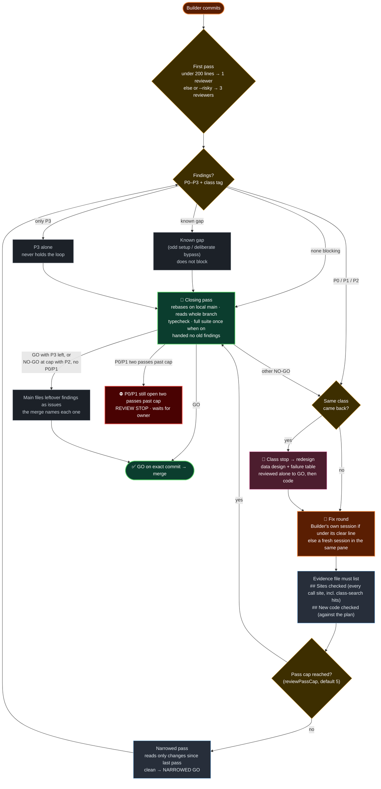

<h1 align="center">Commandeck</h1>

<p align="center">
  
  
  
</p>

---

Commandeck is a Claude Code plugin that runs on
[Orca](https://github.com/stablyai/orca). It is for one person who directs
several coding agents at once and wants every change reviewed by a separate
agent before it reaches `main`.

It splits the work into roles:

- **Main (the orchestrator).** One Claude session in your main checkout. It
  plans with you, launches builds and merges them. It does not write the code.
- **Plan author and plan judges.** Optional seats that write a plan for a
  larger build and judge it before the build starts.
- **Builder.** One session per batch of work, in its own git worktree. It may
  start Sonnet and Haiku helpers, and ask the reviewer's Codex a read-only question
  (`scripts/codex-ask.sh`; the Codex helper cannot edit).
- **Fixer.** The session that fixes a Builder's branch after a review finds a
  problem.
- **Reviewer.** A separate Codex or Claude session that reads what the
  Builder committed. The merge takes a branch only when the reviewer's verdict
  for that exact commit is GO.
- **Chief of Staff (optional).** A relay pane: you talk to it, and it carries
  your decisions to main.
- **Fast lane and Research lane.** Two standing worktrees setup makes beside the
  relay: the Fast lane does small work and has it reviewed before main lands
  that exact commit; the Research lane answers questions and never builds.

You choose the work, answer decisions and push the finished commits. The
merge is local; Commandeck never pushes.

## How it works

### Who does what

```mermaid
flowchart LR
  you(["👤 You<br/>choose work · answer decisions · push"]):::you
  cos["🛰️ Chief of Staff<br/>relay pane (optional)"]:::relay
  main["🧭 Main<br/>orchestrator<br/>plans · launches · merges<br/>never writes the build's code"]:::main
  dash[["📊 Dashboard<br/>builders by stage · waits on you<br/>PRs · issues · limits"]]:::dash

  subgraph plan["📝 Plan stage (tier picked from the brief)"]
    direction TB
    tier{"Plan tier?"}:::gate
    author["Plan author"]:::seat
    judge["Plan judge(s)<br/>one or a panel of two"]:::seat
    tier -- "no plan" --> skip(("→ build")):::seat
    tier -- "plan + judge(s)" --> author --> judge
  end

  subgraph wt["🌿 Unit worktree (one per build)"]
    direction TB
    builder["🔨 Builder<br/>works · commits<br/>may use Sonnet/Haiku helpers<br/>and read-only Codex"]:::build
    loop["🔁 Review loop<br/>(see the next diagram)"]:::review
    builder --> loop
  end

  merge["🔀 Squash merge into local main<br/>merge check on squashed tree<br/>closes the brief's issues"]:::merge
  push(["⬆️ Push — only you"]):::you

  you <--> cos
  cos <--> main
  you -. "yes that names the unit<br/>= build order" .-> main
  main --> tier
  judge -- GO --> builder
  skip --> builder
  loop -- "closing GO on exact commit" --> merge
  main --> merge
  merge --> push
  main -.-> dash
  dash -.-> you

  subgraph lanes["Standing lanes beside the relay"]
    fast["⚡ Fast lane<br/>small work, reviewed<br/>before main lands it"]:::lane
    research["🔬 Research lane<br/>answers questions<br/>never builds"]:::lane
  end
  main --- lanes

  classDef you fill:#1f6feb,stroke:#58a6ff,color:#fff,stroke-width:2px
  classDef relay fill:#6e40c9,stroke:#a371f7,color:#fff
  classDef main fill:#0b3d2e,stroke:#3fb950,color:#fff,stroke-width:2px
  classDef dash fill:#21262d,stroke:#8b949e,color:#e6edf3
  classDef gate fill:#3d2e00,stroke:#d29922,color:#fff
  classDef seat fill:#272e3a,stroke:#79c0ff,color:#e6edf3
  classDef build fill:#5a1e02,stroke:#f0883e,color:#fff,stroke-width:2px
  classDef review fill:#4c1d2e,stroke:#f778ba,color:#fff
  classDef merge fill:#0b3d2e,stroke:#56d364,color:#fff
  classDef lane fill:#1c2128,stroke:#6e7681,color:#c9d1d9
```



### The review loop



A first pass that ends GO with nothing committed after it merges without a
closing pass, and a project with the closing pass off merges the narrowed pass
that ends GO.

## Screenshots


The dashboard shows every Builder by stage, what waits on you, pull requests,
issues, and your Claude and Codex limits. (Sample project, invented figures.)


Orca with the Chief of Staff pinned, main orchestrating and one worktree per Builder.

Inside Claude Code, the units view shows the live units, merges and test runs
as a band above the prompt, a `Units` side pane and a status line, with
today's cost split by merged units, units in flight, main and the standing
panes. More: [docs/dashboard.md](docs/dashboard.md).

## What you need

- [Orca](https://github.com/stablyai/orca), with its command named `orca-ide` on your `PATH`
- Claude Code 2.1.271 or later, signed in
- git, and the GitHub CLI (`gh`), signed in
- `jq`, `perl`, ripgrep (`rg`), Python 3.11+, Bash 4+ and the GNU tools
- macOS (launchd) or Linux (systemd user services). On Windows, use WSL.
- For the Codex reviewer: the Codex CLI and the `openai-codex` Claude Code
  plugin, both signed in

The Sol plan judge runs Codex read-only for files, but with network on and your
`gh` sign-in, so it can write to GitHub and reach any host. Every guard
still runs in its pane. The Fable judge is a Claude pane with the write tools
denied.

Setup checks all of this and prints the exact step for anything missing.
The full list is in [docs/requirements.md](docs/requirements.md).

## Install

Add this repository as a Claude Code marketplace, then install the plugin.
Replace `<marketplace-source>` with this repository's GitHub owner/repository
or the path to a local clone.

```text
/plugin marketplace add <marketplace-source>
/plugin install commandeck@commandeck
```

Open Claude Code in your project's primary git checkout on `main`, then run:

```text
/commandeck:setup
```

Setup asks its questions, shows a preview of every file it would create or
change, and writes nothing until you choose Apply. It never commits. Then
check the wiring:

```text
/commandeck:doctor
```

Setup prints the line to start main with,
`claude --settings .claude/main-session.settings.json`. That file turns off
plugins and skills main does not need; only main reads it. Start fresh
sessions after setup.

More: [docs/install.md](docs/install.md).

## What setup asks

Each question explains its choices, offers the recommended one first (a saved
answer first on a rerun) and is asked only when it applies.

| Question | Choices |
|---|---|
| Reviewer | Claude (a second, read-only Claude session) or Codex (offered when the Codex CLI is ready) |
| Permissions | This project (`.claude/settings.local.json`, which git never sees) or every project (`~/.claude/settings.json`) |
| Your rules | Only with a `CLAUDE.md` or `.claude/rules/`: merge (the plugin's rules you already state are left out; you choose for each rule that says the same in other words or disagrees) or keep both |
| Own startup, Own main | Only with your own `AGENT_STARTUP.md` or `.claude/main-session.md`: merge, replace or skip |
| Global rules, Global CLAUDE | Merge into, add as a block to, or skip `~/.claude/CLAUDE.md` (install or skip when it does not exist). Your own text is never changed. Rarely needed rule text stays in the plugin's details file, behind one-line pointers |
| Settings | The recommended set (every `/plugin` config option at its recommended value), choose groups (models, plan seats, reviewer, review workflow, caches, builders and wakes, unit views, auto-decide) or keep saved. `--option <key>=<value>` sets any one |
| Context | 200K or a larger window |
| Builder clear line | 180K, 150K, 250K or off: past it the Builder goes on in a fresh session |
| Issue sizing | 40K, 30K, 60K or off: a large independent issue is proposed as its own unit |
| Hook trust | Codex reviewer only: whether to trust every hook in the Codex home before each Codex launch |
| Relay, Relay voice | No relay, or a Chief of Staff pane with a name and a one-line voice. The Fast-lane and Research-lane worktrees are always made |
| Dashboard | On for this machine only, off, or on under another name (it then listens on the network, behind a login) |
| Merge check, Full suite | The command that must pass before a merge, or none; and whether the closing review pass runs it once on the build's tip |
| Typecheck, Screen code | The typecheck that must be green before a closing review pass, or none; and the folders of screen code, whose changes merge only with screenshot evidence |
| Lockfile reads | Deny (the default) or allow built-in reads of the project's tracked lockfiles; shell search such as `rg` still works |
| Strict hooks | Off (safety hooks only) or on (also search before reading, and one test run per change) |
| Auto mode | Add two lines about the plugin's scripts to the auto-mode classifier's list, leave it, or take setup's lines out |
| Worker cuts, Keep words | Extra skills and plugins to turn off in worker panes, and words that bring a set back for one unit |
| Add-ons | All, serena, agent-browser or none |
| Review loop | Defaults, keep saved, or tune: the blocking severity, the pass cap, a fresh closing reviewer, the closing pass, the small-build line and when a finished build is flagged for a written review |

After Apply, setup prints what it did, what needs you and what is optional,
and offers a small demo build. Every question in detail:
[docs/setup-questions.md](docs/setup-questions.md).

## Commands

| Command | Use it for |
|---|---|
| `/commandeck:setup` | First-time setup, and changing saved answers |
| `/commandeck:doctor` | A check of the wiring; updates Codex when a newer one is out |
| `/commandeck:update` | Repoint a project after a plugin update |
| `/commandeck:uninstall` | Remove a project's wiring |
| `/commandeck:handoff` | Save a checkpoint and restart main in a fresh pane |
| `/commandeck:worktreereview <unit>` | An HTML report of where a build's time, tokens and cost went |
| `/commandeck:revoke` | Take out one of setup's settings in an Orca profile, or keep your own value |
| `/test-audit <folder>... [basic\|full\|prune] [N agents]` | A report of tests that are redundant, slow or missing; it changes no test. `prune` proposes only removals and merges, each naming the test that still covers it |
| `/autodecide on\|off\|status` | Let the relay pane decide for you while you are away |
| `/units` | Print the live units, merges and test runs; `/units band\|pane\|status on\|off` turns a view on or off for the session |

Setup adds `/test-audit` as a project workflow. `/autodecide` is in the seats
`autoDecideSeats` names; it shows a band and a status-line count while it is
on, and logs every decision. Details: [docs/commands.md](docs/commands.md).

Under Orca, each launch copies your home settings file over the profile's
settings file. Commandeck then puts setup's settings back: the status line,
plugin options, auto-mode lines and permission rules. A hand edit of one of
these in the profile's file is undone at the next launch. Use
`/commandeck:revoke` to take one out for good, or to keep your own status
line or option. `/commandeck:revoke undo` takes a choice back.

## How a build runs

1. You tell main what you want in plain words. Main writes a batch brief
   with you. Only your yes that names the unit is a build order.
2. Main picks a plan tier from the brief: no plan, a plan and one judge, or a
   panel of two judges. A plan is never a build order. `scripts/unit-drive.sh
   start` can carry the unit from there: it runs only the plan seats the tier
   names, one judge round, and the launch, and stops once, naming the next
   command, when a stage needs main. A plan has one goal line, one line per
   step and a list of facts, each naming the file lines it rests on and the
   day they were read; a fact whose lines do not exist is refused before any
   judge reads the plan. A unit over the size limits is split unless main
   writes down why it stays whole.
3. Main launches a Builder in its own worktree. The Builder works, commits and
   runs the review loop. It builds only what the plan asks for, never a
   disabled or "coming soon" stand-in, and follows the shipped test rules
   whenever it writes, changes or deletes a test.
4. When the last pass is GO, the unit merges into local `main` as one squash
   commit. The merge check runs on the squashed tree, and the merge closes the
   issues the brief lists under `Closes:`. A change to screen code merges
   only with screenshot evidence or a stated reason that nothing visible
   changed.
5. You push when you choose.

Walk-through of a first build: [docs/first-build.md](docs/first-build.md).

## The review loop

- **First pass.** One reviewer for a build under 200 changed lines, otherwise
  three, each leading with its own angle. A `--risky` launch always gets
  three.
- **Findings.** Each finding names a file, a line and the failing input, with
  a level (P0 to P3) and a class tag. A finding blocks the merge when normal
  use would hit it. One that needs an odd setup or a deliberate bypass is a
  known gap and does not block. A P3 alone never holds the loop.
- **Threshold and cap.** A P0, P1 or P2 runs a fix round. From the fifth pass
  on record, `review` runs as the closing pass, and main files a P2 or P3 left
  there as an issue before the merge. A P0 or P1 is never capped: one still
  open two passes past the cap stops the build and waits for the owner.
- **Placeholder UI and tests.** A disabled control or "coming soon" copy that
  no plan or ruling asked for is a P1. Every reviewer judges each new, changed
  or deleted test by the shipped test rules: a test is never weakened, skipped
  or deleted to make it pass.
- **Fix rounds.** After a NO-GO the fix round goes to the Builder's own
  session while its context is under the Builder clear line and it already
  runs the round's model and effort; otherwise to a fresh session.
  Before the next pass, the evidence file must list every other call site of
  the flaw (`## Sites checked`) and each read, write or check the fix added,
  checked against the plan (`## New code checked`).
- **Class search.** A reviewer can add a `Class search: rg <arguments>` line
  to a finding. The pass runs that search with ripgrep, without a shell, and
  hands the hits to the fix round. The next pass refuses to start until every
  hit is listed under Sites checked.
- **Class stops.** A finding class that comes back after an earlier pass
  stops the loop on that class. The fix is a redesign: the plan's data design
  and the failure table first, reviewed alone to GO, then the code, then a
  pass over the whole branch.
- **Narrowed and closing passes.** Later passes read only the changes since
  the last pass and end `NARROWED GO`. The closing pass rebases onto local
  `main`, reads the whole branch and, when the full suite is on, runs the
  test command once. It is handed no earlier finding. Its GO is the one that
  merges.

`reviewPassCap` sets the pass at which the loop ends, and `reviewBlockSeverity` the lowest finding that holds a merge. More: [docs/review-loop.md](docs/review-loop.md).

## Configuration

Each setting below is a `/plugin` config option. Setup fills the empty ones
from its answers. A per-launch pin beats the option, and the option beats the
project's routing file. `project` means "use the project's default". The
default for each role is in [docs/configuration.md](docs/configuration.md).

**Main and Builder**

| Option | Values | What it sets |
|---|---|---|
| `orchestratorModel` | `project`, `opus`, `sonnet`, `fable` | Main's model (project: Opus) |
| `orchestratorEffort` | `project`, `low`, `medium`, `high`, `xhigh`, `max` | Main's effort (project: medium) |
| `builderModel` | `project`, `opus`, `sonnet`, `fable` | Each Builder's model (project: Opus) |
| `builderEffort` | `project`, `low`, `medium`, `high`, `max` | Each Builder's effort (project: medium) |
| `maxBuilders` | a number, or empty | The most Builders that run at once over all units (empty: no cap) |

**Fixer**

| Option | Values | What it sets |
|---|---|---|
| `fixerEnabled` | `true` (default), `false` | Off: every fix round keeps the Builder's model and effort |
| `fixerFirstModel` | `project`, `builder`, `opus`, `sonnet`, `fable` | The first fix round's model (project: the Builder's launched model) |
| `fixerFirstEffort` | `project`, `builder`, `low`, `medium`, `high`, `xhigh`, `max` | The first fix round's effort (project: the Builder's launched effort) |
| `fixerModel` | `project`, `opus`, `sonnet`, `fable` | Later fix rounds' model (project: Opus) |
| `fixerEffort` | `project`, `low`, `medium`, `high`, `xhigh`, `max` | Later fix rounds' effort (project: medium) |

**Reviewer**

| Option | Values | What it sets |
|---|---|---|
| `codexReviewerAgent` | `project`, `codex`, `claude` | Who runs the review passes |
| `codexReviewerModel` | a family (`sol`, `astra`), a model id, or `opus`, `sonnet`, `fable` on Claude | The reviewer's model (project: sol, or sonnet on Claude) |
| `codexReviewerEffort` | `project`, `low`, `medium`, `high`, `xhigh`, `max` | The reviewer's effort (project: medium, or high on Claude) |
| `codexReviewerFast` | `true`, `false` (default) | The fast tier, which costs more |
| `reviewBlockSeverity` | `P1`, `P2` (default), `P3` | The lowest severity of finding that holds a merge |
| `reviewPassCap` | a number, 1 or more (default 5) | From this many passes, a closing NO-GO with no P0 or P1 ends the loop with its findings open |
| `freshClosingReviewer` | `true` (default), `false` | The closing pass is handed no earlier finding or fix note |
| `closingPass` | `true` (default), `false` | One more pass over the whole branch after the narrowed passes end GO |
| `fullSuiteBeforeFinal` | `true` (default), `false` | The closing pass runs the test command once on the build's tip |

**Planning**

| Option | Values | What it sets |
|---|---|---|
| `planAuthorEnabled` | `true` (default), `false` | Off: no plan; builds launch with `--skip-plan` |
| `planAuthorModel` | `project`, `opus`, `sonnet`, `fable` | The plan author's model (project: Opus) |
| `planAuthorEffort` | `project`, `low`, `medium`, `high`, `xhigh`, `max` | The plan author's effort (project: high) |
| `planAuthorFast` | `true`, `false` (default) | The fast tier |
| `planJudgeSolEnabled`, `planJudgeFableEnabled` | `true` (default), `false` | Whether each judge reads the plan; with both off the plan installs unjudged |
| `planJudgeSolAgent` | `project`, `codex`, `claude` | Who runs the Sol judge (the Fable judge always runs on Claude) |
| `planJudgeSolModel`, `planJudgeFableModel` | a family, a model id, or a Claude model | Each judge's model (project: sol on the Sol judge, or sonnet on Claude; fable on the Fable judge) |
| `planJudgeSolEffort`, `planJudgeFableEffort` | `project`, `low`, `medium`, `high`, `xhigh`, `max` | Each judge's effort (project: high) |
| `planJudgeSolFast`, `planJudgeFableFast` | `true`, `false` (default) | The fast tier |

**Wakes, relay and panes**

| Option | Values | What it sets |
|---|---|---|
| `wakeKinds` | comma-separated Orca message types | The messages that wake main (default `worker_done,escalation,question,decision_gate,merge_ready`); others wait for the next wake |
| `wakeWindowSeconds` | a number (default 60) | Messages within this many seconds wake main once; 0 wakes at once |
| `autoDecideSeats` | `chiefOfStaff` (default), `chiefOfStaff,main`, `off` | The seats that have `/autodecide` |
| `mainPromptCacheTtl` | `1h` (default), `5m`, `leave` | Main's prompt cache, for a main started with `claude --settings .claude/main-session.settings.json`; `leave` writes nothing |
| `workerPromptCacheTtl` | `5m` (default), `1h`, `leave` | Builders' and other worker panes' prompt cache, subagents too |
| `relayPromptCacheTtl` | `1h` (default), `5m`, `leave` | The relay pane's prompt cache |

**Units view**

| Option | Values | What it sets |
|---|---|---|
| `unitsBand`, `unitsPane`, `unitsStatus` | `auto` (default), `on`, `off` | The band above the prompt, the side pane and the status line. `auto` is on in main and the Chief of Staff, off in worker and reviewer panes |

**Dashboard**

| Option | Values | What it sets |
|---|---|---|
| `dashboardBind` | an address (default `127.0.0.1`, this machine only) | The address the dashboard listens on, from the next setup |
| `dashboardPort` | 1024 to 65535, or empty | The dashboard's port (empty: the first free port from 8791), from the next setup |

Codex fast tier needs `service_tier = "fast"` in Codex's `config.toml`.
Project answers that are not options (the merge check, strict hooks, the
relay and others) live in `.claude/commandeck.json`; change them with setup.
`keepWorktrees` there lists the standing worktrees whose panes are never
closed; without it, the ones the plugin creates are kept.

## Update

```bash
claude plugin update commandeck
```

Then, in each configured project:

```text
/commandeck:update
```

Update reruns setup with your saved answers and runs the doctor. If it fails,
it restores the recorded files. Start new sessions after updating.

## Uninstall

In each configured project, while the plugin is still installed:

```text
/commandeck:uninstall
```

The skill asks whether to keep or delete the data Commandeck gathered. Then
remove the plugin:

```bash
claude plugin uninstall commandeck
```

Uninstall takes out only what setup added. Details:
[docs/uninstall.md](docs/uninstall.md).

## Removed in recent versions

- Red proofs: `scripts/red-proof.sh` and the `Mutation-verified:` line
  (0.28.0).
- The P2 tail: findings left open at a merge, and `file-open-findings.sh`
  (0.29.0). Today only a closing pass at the cap can leave a P2 or P3 open,
  and main files each one as an issue before the merge.
- Setup's `--builder-model`, `--builder-effort`, `--codex-model`,
  `--plan-models`, `--plan-fast` and `--codex-fast` flags, and the plugin's
  own agent files (0.26.0). Use `--option <key>=<value>` or `/plugin` config.
- The ponytail add-on, its `--ponytail` and `--no-ponytail` flags and its
  `ponytail` option (0.48.0). Nothing replaces them.
- The single prompt-cache answer, `--cache-ttl` (0.48.0). Use
  `mainPromptCacheTtl`, `workerPromptCacheTtl` and `relayPromptCacheTtl`.
- The old second-judge options (0.48.0). The Panel's second judge is the
  Fable judge, set with the `planJudgeFable*` options.

What each version changed: [CHANGELOG.md](CHANGELOG.md).

## Working on Commandeck

The plugin's own tests are shell tests:

```bash
bash scripts/run-shell-tests.sh            # the whole suite
bash scripts/run-shell-tests.sh --changed  # the merge check: tests the change touches
bash scripts/run-shell-tests.sh --skip-passed  # a retry: skips files that passed at this same tree
```

Files run on the peer machine are never skipped, and a run with a test-case selector set
records and reuses nothing.

**Test hand-off to a second machine.** In a Mac linked worktree, the shell
tests can run on another machine. Write `pc` in
`~/.config/devenv/chain-host` and an ssh destination in
`~/.config/devenv/peer`. The runner then sends the worktree's exact tree,
uncommitted work included, to the peer. The tests run there in a scratch
worktree under `~/.cache/commandeck-offload/`, inside a memory cage, and
their result is the run's.

- A test file marked `# host: mac` in its first lines stays on the Mac.
- The main checkout, and the peer itself, never hand off.
- When the peer cannot be reached, the tests run on the Mac once.
- When the peer refuses the tree, the run fails with exit 2 and runs nothing.
- When the connection drops after the tests started, the run fails and the
  tests do not run again on the Mac. The run keeps going on the peer; collect
  its result once with `bash scripts/peer-offload.sh --fetch <id>`, the id the
  failure message names.

More: [docs/tests.md](docs/tests.md) and [CONTRIBUTING.md](CONTRIBUTING.md).

## More

- [Requirements](docs/requirements.md)
- [Install and update](docs/install.md)
- [What setup asks](docs/setup-questions.md)
- [Commands and skills](docs/commands.md)
- [Roles and configuration](docs/configuration.md)
- [The first build](docs/first-build.md)
- [Review passes](docs/review-loop.md)
- [Hooks](docs/hooks.md)
- [What each pane starts with](docs/worker-panes.md)
- [Chief of Staff](docs/chief-of-staff.md)
- [Cost control](docs/cost-control.md)
- [Checkpoints, resume and handoff](docs/checkpoints.md)
- [Dashboard, build review and test audit](docs/dashboard.md)
- [Fixture proof run](docs/proof-run.md)
- [Add-ons](docs/add-ons.md)
- [Auto permission mode](docs/auto-permission-mode.md)
- [Layout of this repository](docs/layout.md)
- [Uninstalling](docs/uninstall.md)
- [Troubleshooting](docs/troubleshooting.md)
- [Security and privacy](docs/security.md)
- [Tests and contributing](docs/tests.md)

## Support

Best effort, no guaranteed response time. Report problems in the Issues tab
of this repository. Include the output of the command that failed, and the
output of `claude --version`. Report security vulnerabilities privately; see
[SECURITY.md](SECURITY.md).

## Licence

[Apache-2.0](LICENSE). Third-party work and add-on licences: [NOTICE](NOTICE).
